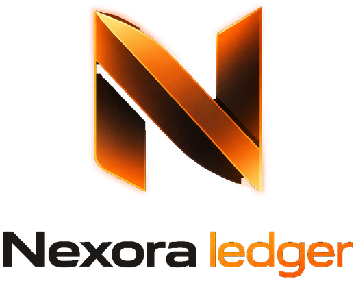
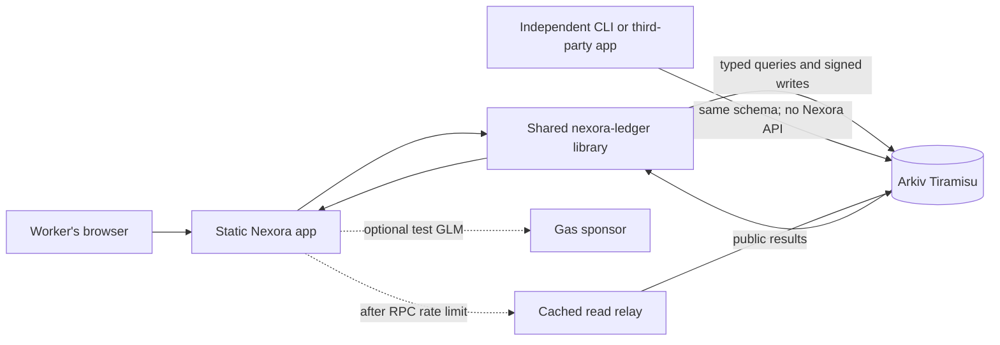
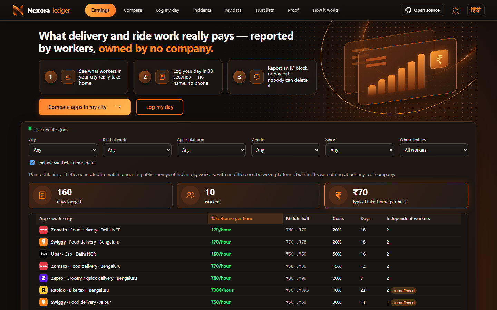
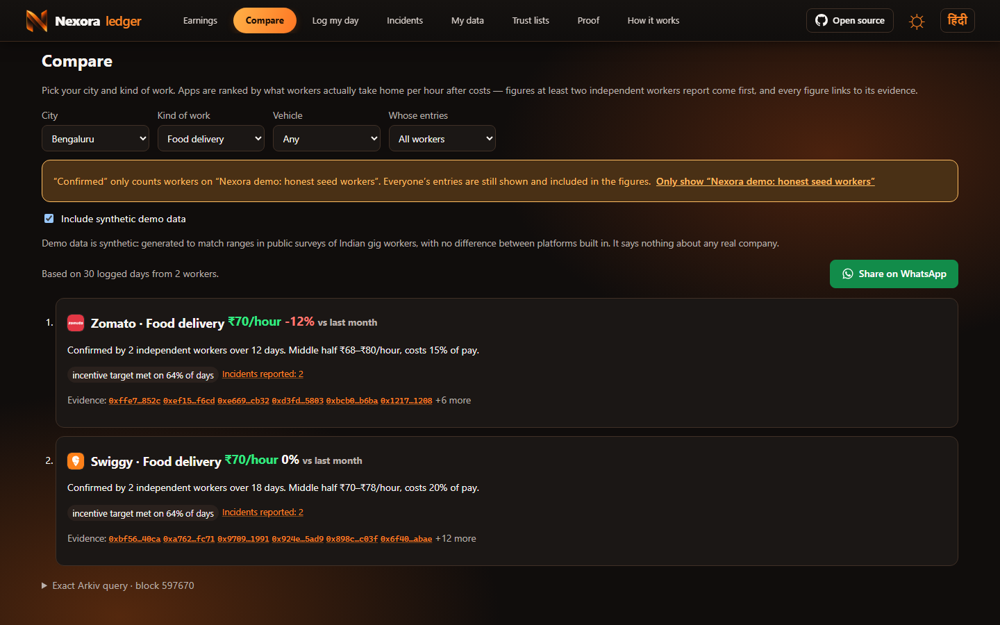
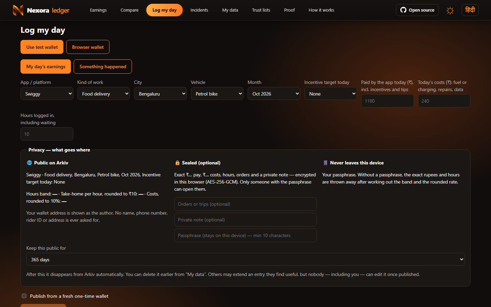
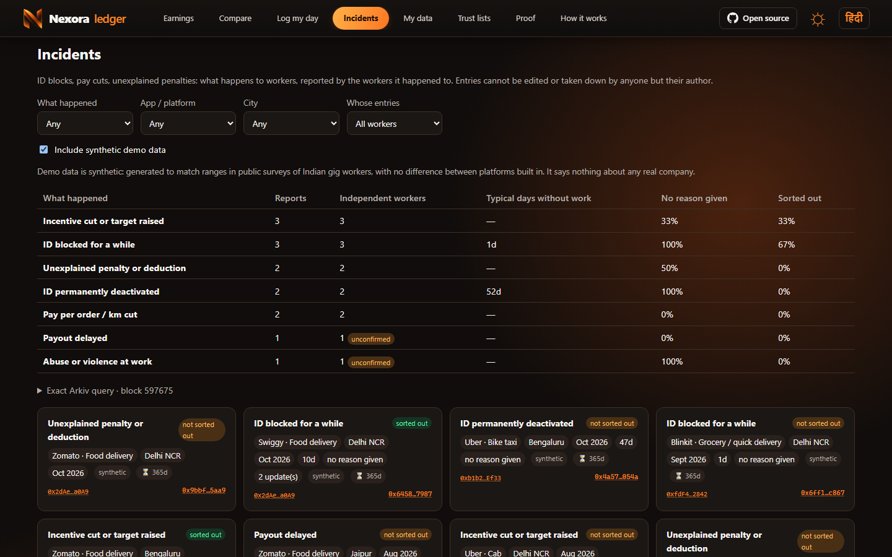

<p align="center">
  <picture>
    <source media="(prefers-color-scheme: dark)" srcset="docs/assets/logo-dark.png">
    
  </picture>
</p>

# Nexora Ledger

**A worker-written record of what gig work in India pays, and what happens when the work goes wrong.**

[Live app](https://nexora-pi-snowy.vercel.app) · [Data contract](arkiv/schema.md) · [JSON Schemas](arkiv/schema) · [npm: `nexora-ledger`](https://www.npmjs.com/package/nexora-ledger) · [Independent reader](examples/read-without-nexora.mjs) · [On-chain evidence](arkiv/evidence.json) · [MIT license](LICENSE)

[](https://github.com/GuTS805/Nexora/actions/workflows/ci.yml) [](https://github.com/GuTS805/Nexora/actions/workflows/audit.yml) [](https://www.npmjs.com/package/nexora-ledger) [](LICENSE)

Food delivery riders, grocery couriers, and cab, auto, and bike-taxi drivers can record a shift's **take-home pay after costs** or report an **ID block, pay cut, or penalty**. Other workers can compare pay by city, app, work type, vehicle, and month. Unions and researchers can query the same records directly from Arkiv without Nexora's website or permission.

Nexora is a **testnet prototype**. Seed entries are synthetic and labelled. A wallet signature shows who published a claim; it does **not** verify a payslip or prove that an incident happened.

## Why this exists

Platforms hold detailed pay and account records, while workers see only fragments of their own history. A worker weighing two apps or a move to another city needs to know what people take home after fuel and other costs. A worker reporting a blocked account may also need to avoid attaching their name or rider ID to the report. Nexora makes comparable, inspectable records available across platforms while keeping names and exact figures out of public attributes.

## The product in three flows

### 1. Learn before taking a shift

1. Open **Earnings** and filter shifts by city, work type, app, vehicle, and month.
2. Open **Compare** to see take-home pay per hour and month-on-month change. Results backed by at least two distinct *trusted* publisher wallets rank ahead of single-wallet claims.
3. Inspect underlying entries, their Arkiv creator addresses, and the exact query used to fetch them. Switch trust lists to see how the answer changes.

### 2. Record work without publishing identity

1. Open **Log my day** and enter pay, costs, and hours. A preview separates public fields, optional encrypted fields, and values kept on the device.
2. Publish one shift or import several through CSV. Public fields contain controlled categories, a rupee band, and a rounded hourly rate. Exact values can be encrypted in the browser with a passphrase.
3. Choose an entity lifetime of 7, 30, 90, or 365 days. The entry links to its Tiramisu entity and creation transaction. **My data** finds entries from this browser's wallets.

### 3. Report an incident and follow up

1. Open **Incidents** to read reports of ID blocks, pay cuts, and penalties, filtered by place, platform, type, and time.
2. Publish from a fresh one-time wallet by default, reducing linkage with the worker's other entries.
3. Post a later update as a new read-only entity linked to the original by a typed `parent` key. The original is not silently rewritten.

The web UI supports English and Hindi. Reading needs no account or wallet.

## Architecture



Arkiv is the primary data layer. The static browser app reads it directly through the official SDK; the CLI and [standalone example](examples/read-without-nexora.mjs) do the same. The optional server functions sponsor test gas and relay cached reads after the public RPC rate-limits a visitor. Neither stores the ledger. The browser can use another Tiramisu RPC, and the CLI accepts `--rpc`.

| Layer | Responsibility | Code |
| --- | --- | --- |
| Static app | Earnings, comparison, logging, incidents, trust lists, proof, English/Hindi UI | [`web/src`](web/src) |
| Data contract | Validate untrusted entities, encode writes, build queries, compute summaries, encrypt optional details | [`ledger/src`](ledger/src) |
| Arkiv entities | Queryable attributes, payloads, creator metadata, expiration, flags, lineage | [`arkiv/schema.md`](arkiv/schema.md) |
| Optional functions | Sponsor test GLM; cache an Arkiv query briefly on rate limit | [`api/`](api) |
| Evidence and tooling | Seed synthetic data, verify transactions, independent reads, tests | [`scripts/`](scripts), [`examples/`](examples), [`arkiv/evidence.json`](arkiv/evidence.json) |

### Data and privacy boundaries

The two main entity kinds are **`shift`** and **`incident`**. Typed attributes hold values needed for filters or ranges, such as city, work type, platform, month, and incident type. Display-only fields and an optional encrypted box live in the payload. Authorship comes from Arkiv's engine-set **`$creator`**, never a self-declared author field.

Published shifts and incidents use `readonly`; the owner can still delete an entity, and anyone can pay for a permitted lifetime extension. A separate, editable **`trust_list`** lets groups curate publisher wallets. Nexora validates every entity it reads because anyone can publish data with the same app marker. See the [exact attributes, vocabularies, queries, and lifetimes](arkiv/schema.md).

**Off Arkiv:** worker names, phone numbers, rider IDs, vehicle numbers, addresses, unencrypted exact earnings, passphrases, and wallet keys. Browser-held keys and preferences stay on that device. Public wallet addresses, timestamps, city, and work patterns can still be correlated; the [threat model](docs/THREAT_MODEL.md) explains this residual risk and the one-time-wallet option.

## Screenshots

Captured from the current local production build at 1440 × 900. The displayed example entries are **synthetic demo data**.

| Earnings: compare take-home pay by city and app | Compare: inspect ranked options and underlying evidence |
| --- | --- |
|  |  |

| Log my day: preview public and sealed fields | Incidents: track blocks, cuts, penalties and updates |
| --- | --- |
|  |  |

## Try it yourself

Use the [live app](https://nexora-pi-snowy.vercel.app) to browse synthetic demo data without a wallet. To run locally, use Node.js 20+:

```bash
npm ci
npm run dev                 # http://localhost:5173
npm run typecheck
npm test
npm run build
npm run test:ui             # needs headless Chrome
```

Read directly from Arkiv without the web app:

```bash
npx tsx ledger/cli.ts earnings --demo --city bengaluru
npx tsx ledger/cli.ts compare --demo --city delhi_ncr --work cab
npx tsx ledger/cli.ts incidents --demo
node examples/read-without-nexora.mjs delhi_ncr
npx tsx ledger/cli.ts verify
npx tsx ledger/cli.ts audit       # every Nexora entity on chain vs the JSON Schemas + a personal-data scan
```

The same CLI ships in the npm package, so none of this needs a clone: `npx -p nexora-ledger nexora audit`.

`--demo` includes synthetic seed data. The CLI prints its query; the UI displays the same query beside each result list. The public Tiramisu RPC has an anonymous query budget. If it is exhausted, use a server-side Arkiv Hub access key through `ARKIV_RPC_URL` or another Tiramisu RPC. Never put an access key in client-side configuration.

### Reproduce a write and its proof

1. In the app, open **Log my day**, choose the test wallet, and fund it with test GLM if needed. Inspect the privacy preview before publishing.
2. Publish a synthetic shift. Open its entity and transaction links, then compare `$creator` with the wallet address.
3. Open **Proof** or run `npx tsx ledger/cli.ts verify`. Both inspect the recorded [Tiramisu evidence](arkiv/evidence.json), including batch writes, linked incident updates, a sealed payload, a trust-list change, and a non-owner lifetime extension.
4. Run an independent CLI query above. The [end-to-end report](arkiv/e2e-report.md) records measured Tiramisu behavior; the [friction report](arkiv/friction.md) gives reproducible SDK/RPC observations.

## Build and deploy

The repo uses npm workspaces: `ledger` for the library and CLI, and `web` for the Vite app. Vercel builds the static app from the repository root as configured in [`vercel.json`](vercel.json). The app can also be served from another static host.

```bash
npm run build:portable -w web
```

This creates `web/dist-portable/nexora.html`, a single-file build with inlined JS and CSS. It opens from disk and reads Arkiv directly. The optional gas sponsor needs `NEXORA_SPONSOR_KEY` as a server secret; without it publishers must obtain test GLM. See [`.env.example`](.env.example) for configuration and [CI](.github/workflows/ci.yml) for checks.

## Build on the data

The [schema](arkiv/schema.md) is public and versioned. A union, researcher, journalist, or another app can read compatible entities and count distinct creators without using Nexora's frontend. [`nexora-ledger`](ledger) provides the same decoders, predicates, privacy helpers, and comparison rules as the UI:

```bash
npm install nexora-ledger
```

```js
import { fetchShifts, readClient } from "nexora-ledger";

const { items, rejected } = await fetchShifts(readClient(), { city: "pune", includeDemo: true });
console.log(`${items.length} valid days, ${rejected.length} rejected by the contract`);
```

The contract is also machine-checkable: [`arkiv/schema/`](arkiv/schema) holds JSON Schema (2020-12) files for each entity kind, generated from the same constants as the codec, and usable from any language. `nexora audit` holds every entry on chain to them and scans for personal data; the [privacy audit workflow](.github/workflows/audit.yml) runs it daily. Start with the [SDK-only reader](examples/read-without-nexora.mjs), then follow [CONTRIBUTING.md](CONTRIBUTING.md).

## Limits and status

- Results and incidents are **self-reported**. Trust lists, creator metadata, and distinct-wallet counts help assess claims; they do not prove identity or truth.
- Demo entries are synthetic and are not findings about any real platform.
- Expiration removes live access under Arkiv's rules, but public transaction history and prior copies can persist. Workers should not publish identifying details.
- This is on Tiramisu testnet. The public RPC can rate-limit readers, and the optional sponsor can run out of test GLM.

Built for the **Arkiv Global Tour Stop, 9–18 October 2026**. [Submission notes](docs/SUBMISSION.md) map the product to the India and CROPS tracks; [friction](arkiv/friction.md), [schema](arkiv/schema.md), and [evidence](arkiv/evidence.json) are the technical record. The ≤3-minute demo video link is still pending.

## License and credits

[MIT](LICENSE). Platform marks are used only to identify the apps discussed in records; no platform endorses Nexora. See [CONTRIBUTING.md](CONTRIBUTING.md), [SECURITY.md](SECURITY.md), and [CODE_OF_CONDUCT.md](CODE_OF_CONDUCT.md).
